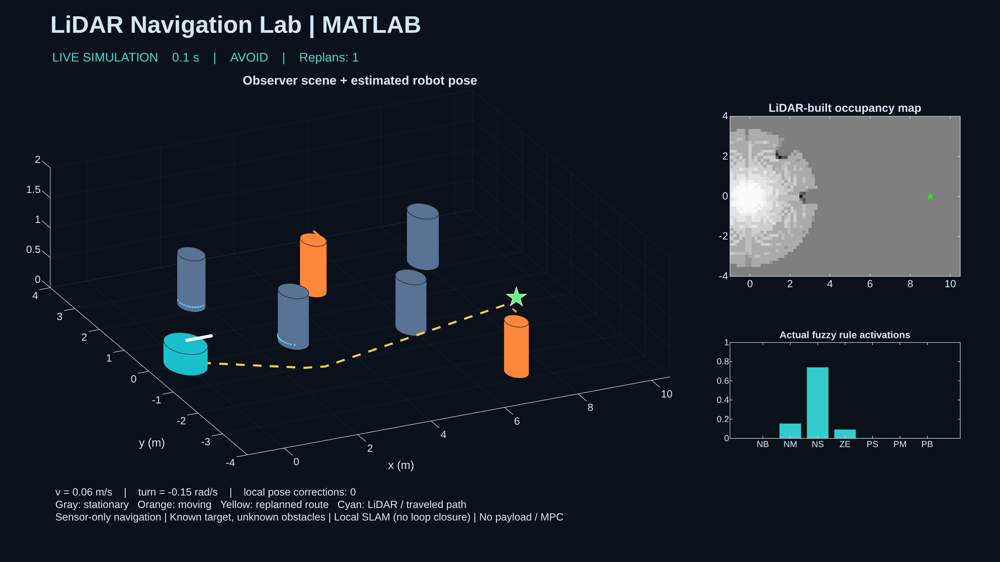

# MATLAB LiDAR Navigation Lab

Native MATLAB simulation; no Python playback, no payload, no MPC.

## Run
Clone or download this repository, open its folder in MATLAB (or upload the files to MATLAB Drive), then run:

```matlab
result = run_matlab_demo(true);
```

Outputs are in `output`: simulation_result.mat, telemetry.csv, summary.json,
preview.png, final_frame.png and video (Motion JPEG AVI, or MP4 when supported).
For simulation without rendering: `result = run_matlab_demo(false)`.
To render saved results: `load output/simulation_result.mat; render_lidar_video(result,'output');`.

## What is implemented
- Bare differential-drive robot with acceleration limits, four static circles and two moving circles.
- Simulated 360-ray, 3.5 m LiDAR; navigation does not receive world obstacle positions.
- Range clustering and circle fitting; nearest-neighbor tracking and velocity estimates.
- Biased noisy odometry with local landmark pose correction and log-odds occupancy mapping.
- Visibility graph and Dijkstra over detected, inflated obstacles; repeated/event replanning.
- Gaussian singleton fuzzy steering and speed control, with bounded adaptive correction.
- Finite-horizon velocity-obstacle rejection and sampled dynamic-window/braking trajectory checks.
- MATLAB graphics rendering: 3D observer view, sensor-built map, actual fuzzy activations.

## Academic scope
This is an educational hybrid adaptation, not a reproduction of the papers' complete algorithms.
Local SLAM has no loop closure or global graph optimization. Ideal LiDAR and circular obstacles
simplify perception. Target [9,0] is known in the starting coordinate frame; obstacles are unknown.
The occupancy map is displayed and updated, while the planner uses tracked LiDAR geometry.
Dijkstra gives a shortest route on the constructed graph, not a globally shortest route through
unknown future moving obstacles. Dynamic avoidance is heuristic and is not a safety guarantee.
No YOLO detector or learned weights are implemented. No ROS/Gazebo dependency in this MATLAB port.

Conceptual references: Dijkstra (1959), Lozano-Perez & Wesley (1979), Elfes (1989),
Fiorini & Shiller (1998), Fox/Burgard/Thrun (1997), Wang & Thorpe (2002), and
Yuan et al., IEEE Transactions on Fuzzy Systems 31(3), 2023 (Gaussian fuzzy concept only;
not its MPC, torque controller, adaptation law or stability proof).

## Validation status
Executed in MATLAB Online R2026b on 2026-11-15. Goal reached in 47.4 simulated seconds;
minimum true clearance 0.3387 m; 221 replans; 214 pose corrections; 5 learned landmarks.
No velocity-obstacle candidate rejections occurred in this particular scenario.
Video rendering completed in MATLAB. The AVI was transcoded to H.264 MP4 with FFmpeg; the recording is 49.4 seconds at 3200 x 1800. These results apply only to the included demonstration.

## Demo video

[Download / watch the MATLAB simulation](videos/simulation.mp4)


